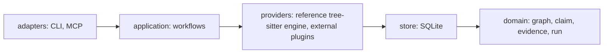

# CompareGraph — design (2026-10-12)

## 1. Intent
CompareGraph is an open-source tool that reads many cloned repositories with a code graph and maps each one onto a shared taxonomy —
family → group → feature → module → symbol → file:line — with evidence on every cell. It tells related clones from unrelated ones by a
score. It exports a browsable vault (Obsidian-style markdown with wikilinks), CSV and JSON, and coding agents (Claude Code, Codex,
Cursor and others) query it through MCP the way they query a code graph. It is for anyone who compares a set of OSS projects with
their own product or with each other.

What it is NOT: a diff tool, a reverse-engineering tool, a wiki written by a model, a fork of any engine.

## 2. Decisions carried into the design (the maintainer, 2026-10-12)
- Fully external: its own repo, licence (Apache-2.0), docs and method. No link to any other project's tree. Study material stays outside the repository.
- A real engine with a persistent store and a call surface — not scripts that re-walk clones on every run.
- Our own STANDARD (the CompareGraph Graph schema) and our own METHOD (markdown skills); external graph libraries plug in as adapters,
  several of them, code-review-graph by default where installed; a reference engine of our own so the tool works with zero external
  install and every adapter has something to be measured against.
- The product shape of morluto/rea (MIT) is the model: evidence with a confidence class, provenance, a typed location and
  limitations on every answer; inward rings; named contracts generated into a catalog; `setup` and `doctor` for agent clients;
  conformance per provider. Nothing of REA's subject (binaries, Ghidra, Hopper) applies.
- **Language (the orchestrator's choice, 2026-10-12, on the maintainer's question "Rust rather than Python?"): Rust core; distribution as the Rust tools in the field do it (superseded detail below).**
  Python is never our base; code-review-graph stays an optional external engine run as a subprocess. The core — parser, store,
  graph, relatedness, exports, the MCP server and the CLI — is ONE Rust crate; tree-sitter's first-class binding is Rust, the
  clones are large (openclaw ≈ 10 M lines, hermes-agent ≈ 1.5 M), and a Rust binary ships with no runtime. Distribution was first
  planned as an npm package of prebuilt binaries; on 2026-10-14 the maintainer dropped npm ("they don't use npm, so skip;
  just follow others") for what the Rust tools in the field ship: release binaries with `SHA256SUMS`, an install script, a
  Homebrew tap, the Claude Code plugin over the installed binary, and the MCP Registry entry
  (`docs/reports/2026-10-13-install-surfaces.md`). `setup` lives in the binary. Cost: a Rust toolchain for contributors
  and minutes of compile per change; one crate, not a workspace.
- Vector search and RAG are built in as RANKING (what to read first, which clones are related) and never write a verdict.
- Licence policy for code taken from others: MIT / Apache-2.0 / BSD modules may be taken whole with their attribution header and
  a row in `THIRD_PARTY_NOTICES.md`; AGPL / GPL / fair-code / community-licensed code is never copied; no product is forked.

## 2b. The workflow — start from a working root or from an empty folder, add OSS, adopt or reject each (the maintainer, 2026-10-12)
A workspace starts in one of two ways and runs the same flow afterwards:
1. **From a working root** — `comparegraph init --root-repo <path>`: your own repository is registered with `role = root`; every clone
   added later is a comparator against it. Claims on the root are "we have it"; claims on comparators are "they have it"; gaps and
   differentiators are derived views.
2. **From an empty folder** — `comparegraph init`: no root; clones are added and compared with each other (prevalence, who has what,
   best-in-class per feature). A root can be promoted later from any clone (`comparegraph root set <repo>`) or added as your own repo.
Then, for every clone: `add` → `build` → `relate` (does it belong in this family at all) → `map` and `claim` (what it has, with
evidence) → **`decide <repo> adopt|reject|park --why …`** — the disposition of the OSS as a whole for this workspace: adopt (we take
from it: which features, under which licence lane), reject (with the reason, the list to challenge later), park (what would un-park
it). The disposition is a row with a date and an author, never a loose note; `export` lists adopted, rejected and parked with their
reasons; a rejected clone keeps its graph and claims (it may be re-decided), it only leaves the derived "adopt" views.
`repo.role ∈ {root, comparator}` (at most one root); dispositions are rows of `decision` (adopt / reject / park, why, by, when,
supersedes) — append-only, the latest wins, no row means `undecided`. **The engine never writes a decision**; it records one a person
(or an agent on a person's instruction, named as the author) makes, and shows what is undecided. Nothing in the engine requires a
root; everything works from the empty folder.

**Tracing (the maintainer, 2026-10-12: "standardised tracing"):** `claim` and `decision` are append-only with a `supersedes_id`; `run` is
dated per build; `location` carries the content hash it was resolved against. Together they answer, for any cell: who wrote it, when,
from which run, against which lines, what it replaced, and whether the code has moved since. `export json` includes the trail; the
vault shows the latest and links the history.

## 2c. Unlimited and unrelated comparisons — families are plugin packs
Comparisons are unlimited because a FAMILY is a self-contained pack, not a column of one spreadsheet: a folder `families/<name>/`
holding `rows.md` (the taxonomy: groups, features, definitions, what counts as `has`, tiers, weights), optional `queries/` (named
graph queries or symbol patterns that give `map` a head start: e.g. "an HTTP route handler", "a retry loop"), optional `README.md`.
Packs are independent: adding `payment-gateways` next to `agent-harnesses` changes nothing in either. A pack can be installed from a
path, a git URL or a published package, the way a skill is. Two clones in unrelated families never meet in a view unless a reader
asks for a cross-family view explicitly. Relatedness (§4) is computed per (clone, family) and answers "does this clone belong in
this comparison at all" before any claim is written.

## 3. Layout — the rings (dependencies flow inward)
```
crates/comparegraph/src/
  domain/        the standard: graph schema, taxonomy, claim, evidence, run — pure, no I/O
  contracts/     serde types for every verb's input and output; the catalog generator (docs/catalog.json)
  providers/     one adapter per engine: reference (tree-sitter), crg (code-review-graph); the conformance runner
  application/   workflows: add · build · relate · map · claim · check · export · search · conform · doctor
  adapters/      cli/ (clap, one-shot) · mcp/ (stdio, rmcp) · the library surface (lib.rs)
scripts/install.sh, install.ps1   the installers (release binary, checksum checked); `setup` for agent clients is in the binary
method/               the markdown skills (the method)
families/             sample taxonomy bases (`<name>/rows.md`)
fixtures/             golden repositories per language with expected graphs (conformance)
docs/                 specs, plans, architecture.mermaid, the generated catalog, THIRD_PARTY_NOTICES.md
```
A module never imports outward. `domain` has no I/O; `providers` know engines, not workflows; `adapters` are thin.

## 4. The CompareGraph Graph — the standard (schema v1)
One SQLite file per workspace, `.comparegraph/comparegraph.db` (rusqlite, bundled). Every table carries `run_id`.
| table | columns (key → …) | meaning |
|---|---|---|
| `workspace` | id, root, created_at | a folder of clones |
| `repo` | id, workspace_id, name, path, remote, head, licence, lane (take/adapt/study), role (root/comparator), category, stars, added_at | the SURFACE: what the project is and says; `role` carries §2b |
| `decision` | id, repo_id, scope (repo/feature), feature_id (NULL for scope repo), disposition (adopt/reject/park), why, decided_by, decided_at, supersedes_id | the DISPOSITION trail (§2b): append-only; scope `repo` decides the whole clone, scope `feature` decides one feature of one clone ("adopt their retry loop"); the latest row wins; no row means `undecided`; the engine records, never writes one on its own |
| `run` | id, repo_id, provider, provider_version, started_at, seconds, status, limitations_json, store_hash | one build; `store_hash` is the determinism check |
| `node` | id, repo_id, run_id, kind (file/module/class/function/method/type/route/test), name, qualified_name, path, line_start, line_end, content_hash, language, provider_ref | a code primitive |
| `edge` | id, repo_id, run_id, kind (contains/imports/calls/implements/tests/routes_to), source_node_id, target_node_id, confidence | a relation |
| `community` | id, repo_id, run_id, label, keywords_json, cohesion, size | a cluster of related nodes (the STRUCTURE level) |
| `community_member` | community_id, node_id | — |
| `family` | id, name, definition_path, definition_hash, source_path | the taxonomy root: `family add` snapshots the pack to `.comparegraph/families/<name>/rows.md` (`definition_path`, workspace-relative), with its sha256 and the directory it came from |
| `feature` | id, family_id, group, slug, definition, counts_as_has, tier (basics/common/ours-only), weight | one row of the taxonomy |
| `relatedness` | repo_id, family_id, run_id, score, band (related/adjacent/unrelated), basis_json | the clone ↔ family score |
| `claim` | id, repo_id, feature_id, run_id, verdict (has/partial/none/unknown), confidence (observed/derived/inferred/unknown), author, note, limitations_json, created_at, supersedes_id | the JUDGEMENT; append-only — a re-confirmation or a change is a new row naming the one it supersedes (a batch skips a row equal to the live claim), so every cell has a trail (who, when, on what evidence, what changed) |
| `location` | id, claim_id, node_id, path, line_start, line_end, content_hash, resolved_at, stale | the PROOF; `stale` flips when the content hash no longer matches |
| `embedding` | owner_id, owner_kind, model, vector (blob) | optional; ranking only |
Rules: a `claim` with verdict `has` or `partial` needs ≥ 1 `location` that resolves, or `check` refuses it. A `none` needs a search
named in `note` (the terms and the count), else it is written as `unknown`. Nothing is ever UPDATEd in `node`, `edge`, `community`
once a run is complete; a new build is a new run; the latest run wins; older runs are history. A `none` whose search finds hits is accepted, as `observed`, only when the author names as read the top 10 ranked candidates of `absent-check --searched` (`--read-hits`); the rest is recorded as a `read_capped` limitation.

## 5. Evidence — every answer says how it knows
`confidence` on every claim and on every tool answer: `observed` (an engine measured it) · `derived` (a citation resolved to a line
with a matching content hash) · `inferred` (a reader or a model judged it; `author` names who) · `unknown`. Every answer carries
`limitations[]`: what the provider cannot see (dynamic dispatch, SQL text, config-driven wiring, unsupported languages, files over
the cap). The `search` verb returns candidates ranked by lexical or vector similarity and labels them `candidate`, never `has`.

## 6. Providers — the adapter contract
```rust
pub trait GraphProvider {
    fn name(&self) -> &str;  fn version(&self) -> String;
    fn detect(&self) -> ProviderStatus;                       // installed? version? last conformance result?
    fn capabilities(&self) -> Capabilities;                   // languages, edge kinds, communities, embeddings
    fn build(&self, repo: &RepoRef, opts: &BuildOptions) -> Result<BuildResult, ProviderError>;  // ONE run
}
```
- **reference** (`providers/reference`): in-process tree-sitter, our own engine. Its parser layer is TAKEN WHOLE from graphmind
  (MIT, upstream `crates/graphmind-core/src/` at 4a90a7e, 2026-10-12: `{registry.rs (trait LanguageParser), extractor.rs (Symbol,
  SymbolKind), languages/*.rs}` — 28 language extractors of ~200–300 lines each, tree-sitter 0.25, no dependency on graphmind's
  db, licence or auth crates) with the attribution header and a `THIRD_PARTY_NOTICES.md` row. Not taken: graphmind's store, MCP,
  memory, desktop, licence and auth crates. Rejected as the parser layer: codegraph-ai/CodeGraph (Apache-2.0) — its per-language
  crates depend on its rocksdb core crate, and one maintainer; code-review-graph — Python. Files, symbols, `contains`, `imports`,
  direct `calls` from the extractors; communities ported from code-review-graph's `communities.py` (Leiden via a Rust graph
  crate, the naming and cohesion heuristics, fixed seed). The reference provider is the baseline every other adapter is
  compared with, and the zero-install path. (The maintainer, 2026-10-12: "I prefer Rust versions — refactor or fork the Rust OSS
  and patch from the Python code, whatever gives the best result faster." Decided: take the parser layer whole, write the
  rest; never a product fork.)
- **crg** (`providers/crg`): runs `code-review-graph build` as a subprocess on the clone (a tool the user installed with pip; never
  a clone we run), reads its SQLite (`nodes`, `edges`, `metadata`, community ids) and maps kinds into the standard. Default when
  installed. Its Leiden communities, names and cohesion are kept; `provider_ref` keeps the original id.
- later: codegraph-mcp (its `--run-tool` one-shots), ripwire (its JSON), srclight.
A provider is used only when `detect()` reports its conformance result green (§7).

## 6b. Plugins — three kinds, in-process or external, one protocol
| kind | what it contributes | in-process form (Rust) | external form (any language) |
|---|---|---|---|
| **provider** | a graph of a clone (nodes, edges, communities) | `impl GraphProvider` | a process on `PATH` named `comparegraph-provider-<name>` speaking the protocol below |
| **family pack** | a taxonomy + optional queries | a folder | the same folder, fetched from a path, a git URL or a package |
| **exporter** | a view of the store (vault, csv, json, …) | `impl Exporter` | `comparegraph-exporter-<name>`, same protocol |
The external protocol is JSON Lines over stdin/stdout, versioned: the host sends `{"comparegraph":"1","op":"capabilities"}`,
`{"op":"build","repo_root":"…","options":{…}}`, `{"op":"export","store":"<path to a read-only snapshot>","out_dir":"…"}`; the
plugin answers one JSON object per line: `{"ok":true,"data":{…}}` or `{"ok":false,"error":{"code":"…","message":"…"}}`,
streaming `{"progress":…}` lines allowed. Every external plugin runs with a timeout, a byte cap on its output and no network unless its
manifest declares it; its stdout is DATA, never instructions (a plugin cannot change what the host does next). `comparegraph doctor`
lists every plugin found, its version and its last conformance result; a provider that has not passed `conform` is listed and not used.
A plugin manifest `comparegraph-plugin.toml` names kind, name, version, protocol version, languages or exports, and whether it needs the
network. The same contract (§9) describes in-process and external plugins, so a user cannot tell which one answered.

## 7. Robustness — measured, not asserted
1. **Conformance.** `fixtures/<language>/` holds small golden repositories with a hand-verified `expected.json` (nodes, edges,
   communities). `comparegraph conform <provider>` runs every fixture and prints precision / recall per kind. An adapter below the
   floor (v0.1: nodes ≥ 0.95, edges ≥ 0.85) is refused.
2. **Agreement.** `comparegraph build --providers a,b` runs two adapters on one clone and writes an `agreement` row per kind
   (Jaccard over qualified names and over edges). Disagreement above 0.2 is written into the run's `limitations`.
3. **Determinism.** `store_hash` = sha256 over the ordered nodes/edges/communities of the run; the same head with the same
   provider version must reproduce it; `check` reports a drift.
4. **Citations.** `check` re-reads every `location`: path exists, lines within the file, content hash matches; a mismatch sets
   `stale` and the claim's `confidence` falls to `unknown` in every export until a reader re-confirms it.
5. **Doctor.** `comparegraph doctor` validates the binary, the store schema version, every provider's install and conformance, and every
   agent-client registration (aligned / stale / missing).
6. **No silent empties.** A build that parses 0 files, a family with 0 rows, an export with 0 claims each exit non-zero with the
   reason; a check that passes while producing no output has not run.
7. **Tests.** Unit tests beside each module; the conformance fixtures double as integration tests in CI; every verb has a red
   test for each refusal in §9.

## 8. The method (superpowers-style, `method/`)
Plain markdown skills, one folder each with `SKILL.md`, loadable by any agent and installable as a plugin:
`adding-a-clone` · `defining-a-family` · `mapping-a-community-to-features` · `writing-a-claim-with-evidence` ·
`reviewing-a-map` · `reading-the-vault`. Each says what to read first, what counts as evidence, what the tool refuses, and how the
work is verified (the command and its expected output). The method is the discipline; the tool enforces the parts it can.

## 9. Verbs (CLI = MCP = library; one contract each, generated into `docs/catalog.json`)
| verb | does | refuses when |
|---|---|---|
| `add <path\|url>` | registers a clone (surface row: head, licence from LICENSE, manifest, stars if a remote) | path missing; licence unreadable → lane `study` with a warning |
| `build [repo] [--provider p] [--providers a,b]` | one run per repo: nodes, edges, communities, store hash | provider not conformant; 0 files parsed |
| `family add <name>` / `family check` | registers `families/<name>/rows.md` (frontmatter: name, groups, tiers; a table: id, definition, counts-as-has, tier, weight) | duplicate ids; a row with no definition |
| `family propose <name> [--repos …]` | a DRAFT taxonomy from the corpus, no LLM: module, community and symbol-name terms that recur across the named clones, with counts per clone, written as candidate rows (`tier: candidate`) a person or an agent edits into `rows.md` (the maintainer, 2026-10-12: "family grouping needs llm right?" — the draft does not; the names, definitions and what counts as `has` do) | fewer than 2 built clones |
| `relate [repo] [family]` | scores each clone against each family; writes `relatedness` | no build yet |
| `decide <repo> adopt\|reject\|park --why … [--by …]` | the disposition of the clone for this workspace (§2b); a new row supersedes the old (history kept in `run`-style dated rows) | empty `--why` |
| `init [--root-repo <path>]` / `root set <repo>` | creates the workspace; registers or promotes the root | a second root |
| `map <repo> <family>` | for each feature, the ranked candidate communities and symbols (lexical, then vector); writes NOTHING | no build; no family |
| `claim <repo> <feature> <verdict> --at path:line [--at …] --note …` | writes a claim with locations; confidence `derived` when every location resolves, else refused | `has`/`partial` with no resolving location; `none` without a named search |
| `check` | citations, determinism, store schema, claims citing a run that was never built (`unbuilt_claim_runs`); non-zero on any red | — |
| `export vault\|json\|csv [--out dir]` | regenerated from the store; the vault: `families/<f>.md` → `repos/<r>.md` → `communities/<r>/<c>.md` → `symbols/<r>/<slug>.md`, frontmatter + wikilinks | 0 claims |
| `search <query> [--repo] [--family]` | ranked candidates over communities, symbols and claims; labelled `candidate` | no index |
| `conform <provider>` | §7.1 | — |
| `doctor` | §7.5 | — |
| `setup` | registers the MCP with each agent client found, additively, plan shown first, backup kept; leaves Claude Code's server and hook to the plugin when it is enabled | — |

## 9b. One envelope for every answer — usable by any tool, cheap in tokens (the maintainer: "any tools, robust standardised, save tokens")
Every verb, on the CLI, over MCP and through the library, answers with the same envelope:
```json
{ "ok": true, "verb": "map", "schema": 1, "data": { … }, "evidence": { "confidence": "observed", "limitations": [ … ] },
  "page": { "next": "<cursor>", "total": 123 }, "cost": { "rows": 40, "bytes": 5120 } }
```
Token economy is a design rule, not a flag: answers are COMPACT by default (ids, names, kinds, file:line; no bodies, no docstrings),
paginated (`--limit`, `--cursor`), field-selectable (`--fields name,path,line_start`), and every list is sorted deterministically so a
client can diff two answers. `--detail full` opens bodies and signatures on request. The MCP tool descriptions carry the same JSON
Schemas as the catalog (`docs/catalog.json`, generated from `contracts/`), so Claude Code, Codex, Cursor, Gemini CLI, OpenCode,
Hermes or a shell script read the same shape. A refusal is `{"ok":false,"error":{"code":"no_resolving_location","message":"…","hint":"…"}}`
with a stable `code` list in the catalog.

## 9c. UI evidence - files, not schema (CMP-UI-1, 2026-11-12)
A product's screens, menus and journeys are compared as files under a root directory (`--ui-root`, default `--root`); the store and
`store/schema.sql` are untouched and nothing is added to `Cargo.toml`. A capture lives elsewhere (a Playwright probe); the engine only
READS, validates, sorts and compares. Formats are the lanes file `CMP-UI-1-lanes.md` (ui-evidence/1 with the `style` block, ui-flow/1,
ui-run/1, ui-registry/1, ui-nav/1, ui-journey/1, ui-coverage/1, `map.csv`); layout under `<ROOT>/ui/`:
`registry.json`, `<product>/<screen>/<state>/<viewport>-<seat>.json`, `<product>/flows/<task>.json`, `<product>/nav/<viewport>-<seat>.json`,
`<product>/system.json`, `runs/<runId>.json`, `coverage/<runId>.json`, `journeys/<journey>.json`, `blobs/<sha256>.png`, `map.csv`.
Rules: the capture key is product@version/screen/state/viewport/seat/locale/theme; **comparison only within the same screen + state +
viewport** (a mismatch is refused with a message, never bridged); each screen's archetype and the per-archetype metric limits come from
the registry; an invalid file is skipped and named in `evidence.limitations` (`invalid_evidence`), never fatal; every listing is sorted and
bounded by `--max-nodes` (default 200, max 2000) with `truncated` stated; screenshots are context (paths and dHash), never compared by bytes.
Metrics, layout and style are read from the evidence JSON as written; recomputing them from `snapshots/<domHash>.json.gz` needs a gzip
reader, which is not in `Cargo.lock` - reported as `snapshot_recompute_pending` until a dependency ruling.

| verb | answers |
|---|---|
| `ui products` / `ui screens <product>` | what exists: screens, archetype, states, captures, flows, menus |
| `ui show <product> <screen> [--state --viewport --seat]` | E1..E12 pass/fail against the archetype limits, layout and style summary, image path |
| `ui diff <screen-or-row> --ours P --ref Q [--state --viewport --seat --ref-seat]` | metric table side by side, layout and style difference in words ("nav columns 3 vs 1; primaries 0 vs 1", "type sizes 11 vs 6, colours 23 vs 12, onScale4 0.71 vs 0.96"), both image paths |
| `ui matrix <family> [--state --viewport]` | family rows x products, cell = pass count / 12 or `-`, through `map.csv` |
| `ui matrix <family> --devices <ids\|all>` | CMP-UI-1i: product x device, cell = `pass/12 <support class>`, `-` or `n/a (absent)` (the probe's coverage states it, with the source); `supportColumns` counts full / degraded / redirect / blocked / absent per product and device. The viewport part of a key is a device id (`desktop-1440`, `laptop-1280`, `ipad-portrait`, `ipad-landscape`, `iphone`, `android`); a capture is judged by the archetype column of its device class (desktop, tablet, phone). A tablet without a `tablet` column is judged <= 1 nav column (E1), <= 12 actions (E4), content start <= 0.25 (E7), `limitSource: tablet-default`. `ui diff` refuses two different devices (`--ref-viewport`) as it refuses two states |
| `ui system <product>` | design system (`system.json`, else the union of its 1440x900 captures) against <= 6 type sizes, <= 12 colours, >= 0.95 on the 4px scale |
| `ui flow <product> <task>` | steps, clicks, dead ends |
| `ui graph <product>` / `ui path <product> <from> <to>` / `ui graph-diff --ours P --ref Q\|target` | the interaction graph (ui-graph/1, `<product>/graph/<viewport>-<seat>.json`): depth from the start, orphans vs the registry, dead actions (effect none/error), duplicate paths, cycles, actions per screen; the shortest click path (bounded by `--max-len`, default 8); depth to each comparable screen against another product or the target tree (`target-nav.json`). Numbers are recomputed from nodes and edges, never read from the probe |
| `ui nav <product>` / `ui nav-diff --ours P --ref Q` | the menu tree and its numbers (places, depth, items per level and group, destinations, duplicates, dead items, items only via overflow); the tree difference in words |
| `ui journey <journey> [--products a,b]` | per product: completed / partial at step N / n/a with the reason, and the journey numbers |
| `ui coverage <runId>` | captured / n/a / failed per product; a blank cell makes the run incomplete and is listed |
| `ui verify <runA> <runB>` | the determinism gate: for every key in both runs domHash equal, metrics equal, image dHash within 4 bits; every difference reported, exit 1 (`check_failed`, list in `data`) when any |

All are read verbs and MCP tools (`comparegraph_ui_*`); confidence is `derived` for the comparing verbs.

## 9d. Store safety, scope and record (lane CG-STORE, 2026-11-12)
A store holds two kinds of data: the graph and the parse cache, rebuildable from the clones; and the claims, locations,
decisions and bands, which are not. The second kind is a few MB inside a file of several GB. These verbs protect it, keep the
file from growing, and let a person take a repo out of scope without losing anything - with no `store/schema.sql` change and
no new dependency (decisions.md, "Store safety").

- **The store-safety verbs never migrate.** `Store::open_read_only` (SQLITE_OPEN_READ_ONLY) for the reads, `Store::open_guarded`
  (read-write, no `ALTER TABLE`) for the writes; a store an older binary wrote is read through temp views and its column set is
  left as it is, so that binary keeps reading it. The writes touch only what schema v1 already leaves writable: `meta` rows,
  `location.stale`, `run.status`, `parse_cache` rows - each named `main.<table>` so a temp view is never the target.
- **`check` is a read** (CLI and MCP). An unreadable clone is `clone_unavailable` (folder missing, or HEAD not the head its run
  read) and nothing is written for it; real drift is reported; `--mark` writes flags and `--mark --recompute` clears the ones
  whose lines hash as recorded again (the reset the sticky flag never had). The `store_hash` re-hash is `--deep`.
- **`backup`**: `VACUUM INTO` (consistent snapshot, compacted) verified by `quick_check` and row counts, or a claims-only JSONL
  read in one snapshot; `backup-manifest/1` beside it. **`restore-store`**: sha256 against the manifest, refused while the store is
  in use, a pre-restore backup, the replaced files moved aside, never deleted.
- **`gc`** (application/retain.rs, keep-rule `domain/retention.rs`): `--parse-cache` keeps the running provider version (n
  newest with `--keep-versions`), then VACUUM; every build prunes, for the files it read, their rows of other versions.
  `--stale-runs` marks a `running` row older than N hours `abandoned`. Dry-run by default; `--apply` refused while the store is
  held. The graph tables keep their append-only triggers; dropping superseded runs waits for the schema ruling (plan phase C).
- **`relevance`** (domain/relevance.rs pure; application/relevance.rs reads): the engine computes factor COUNTS only; weights,
  thresholds, primaries and pins come from the user's `relevance-policy/1` file (unknown keys refused). No policy, no class
  (`unrated`) - the roadmap ruling of 2026-10-13 ("a prioritization formula does NOT go in the tool") holds because the formula's
  numbers live in the user's file. As-of is the newest timestamp in the store; inputs are hashed into the answer.
- **`archive` / `restore`**: soft. Manifest first (`archive-manifest/1`, claims CSV, temp + fsync + rename + re-read), then the
  `meta` flag `archived:<repo>` = the manifest's sha256 and the log entry, all under the store's write lock. Rows stay; the repo
  leaves the default views, `check` never reads it, writes on it are refused (`repo_archived`). The root is never archivable;
  primaries, pins, adopted repos and port sources need `--force-with-reason`.
- **The action log** (`.comparegraph/actions.jsonl`, `action/1`, domain/actionlog.rs): every write verb appends one line, chained
  by `hash = sha256(prev || canonical(entry))`; the head is also in `meta.actions_head`, so a file cut short disagrees with the
  store. `governance verify` re-walks it with the archive flags and manifests; `check` and `doctor` show it.
- **`repos --no-port`**: the licence lanes as one filter; the never-copy set (domain/licence.rs) is a constant a policy may
  only extend.
- **Connection settings**: `synchronous = NORMAL` under WAL, a 64 MiB page cache per connection, `PRAGMA optimize` (bounded by
  `analysis_limit`, never waiting for a lock) when a write verb's store closes. Nothing is stored in the schema.

## 15. Standards honoured (so nothing here is a private format)
MCP (tools/list, JSON Schema inputs and outputs, stdio transport) · JSON Schema 2020-12 for every contract · SPDX identifiers for
licences · RFC 4180 CSV · JSON Lines for the plugin protocol · Obsidian conventions for the vault (YAML front matter, `[[wikilinks]]`,
one note per node, `_index` notes) · the `llms.txt` and `AGENTS.md` conventions as generated files at the vault root so an agent can
orient without reading everything · SQLite as the store (readable by every language) · semantic versioning for the schema, the
protocol and the package.

## 10. Agent surface
`comparegraph setup` detects client config files (twelve clients: Claude Code, Codex, Cursor, Gemini CLI, OpenCode, Hermes, Windsurf,
Antigravity, Kiro, Copilot, Copilot CLI, Qwen Code), shows the planned change, writes additively and idempotently with a backup;
`doctor` reports each as aligned / stale / missing; a bare `comparegraph` command that resolves on `PATH` to the registered binary is aligned, and with the Claude Code plugin enabled `--client all` leaves Claude Code's server and hook to it (`plugin`). Each row carries a `kind`: `config` (the server entry), `rules` (a marked block
in the workspace's instruction file, once a store exists) and `hook` (Claude Code's SessionStart hook, which runs `doctor --brief`).
The MCP server exposes the read verbs (`search`, `map`, `relate`, `export json`, `check`) and `claim` (a write, with the same
refusals). `skills/` (with `method/` as its alias) ships in the repository, where the Claude Code plugin reads it.

## 11. Milestones
- **v0.1** — the standard (schema v1), the store, `domain` + `contracts` + the catalog generator, the reference provider for
  TypeScript/JavaScript and Python, the crg adapter, `add build family map claim check export(vault,json) search(lexical) conform
  doctor`, the MCP read verbs + `claim`, the `method/` skills, conformance fixtures for two languages, a release binary for
  linux-x64. Proven on three real clones: every exported location resolves; the reference and crg adapters agree
  ≥ 0.8 on nodes.
- **v0.2** — Rust and Go in the reference provider, relatedness bands, vector ranking (a local embedding model, optional),
  agreement rows, `setup`, CSV export, macOS and Windows binaries, the docs site.
- **v0.3** — codegraph-mcp and ripwire adapters; many workspaces under one registry; release automation (tags → binaries, the tap, the registry entry).

## 12. Out of scope
Diffing two files; editing code; running any clone; a hosted service; a model writing claims unattended (a model may propose
through `map` and `search`; a claim names its author).

## 13. Taken from others (with attribution, `docs/THIRD_PARTY_NOTICES.md`)
- graphmind (MIT, aouicher/graphmind): the parser layer — `LanguageParser`, `Symbol`/`SymbolKind`, 28 language extractors —
  taken whole into `providers/reference` with the header.
- code-review-graph (MIT): the community detection, naming and cohesion heuristics (`communities.py`) and the Obsidian export
  shape (`exports.py`), ported to Rust with the header; the engine itself is called by the `crg` adapter, not copied.
- morluto/rea (MIT): the shape of `setup` / `doctor` client registration and the evidence base schema, ported with the header.
- tree-sitter (MIT) and the language grammars (MIT), rusqlite (MIT), rmcp (Apache-2.0), clap (MIT/Apache-2.0) as dependencies.

## 14. How we would know the design is wrong
The v0.1 proof on three clones fails one of: a location that does not resolve in the vault; adapters agreeing < 0.8 on nodes;
a reader needing more than the community pages to write a claim (measured as tokens per clone against a plain tree read);
a second person unable to add a clone and a family from `method/` alone. Any of these reopens §4–§7 before v0.2.

## 16. Diagrams

The workflow and the rings as diagrams (moved from the README).

```mermaid
flowchart LR
    clones["cloned repos"] --> engines["engines: reference (tree-sitter), external plugins"]
    engines --> store[("SQLite store, schema v1")]
    store --> graph["communities, search, graph queries"]
    store --> families["families: taxonomy packs"]
    families --> relate["relate and map"]
    relate --> claims["claims with citations"]
    claims --> matrix["matrix: gaps, differentiators"]
    graph --> out["exports and MCP"]
    matrix --> out
    claims --> out
```

The code is arranged in rings; dependencies point inward, and the folders under `crates/comparegraph/src/` carry the same
names. Two engines sit in the providers ring: the built-in reference engine, and any external plugin that speaks the
[plugin protocol](dev/plugin-protocol.md).


